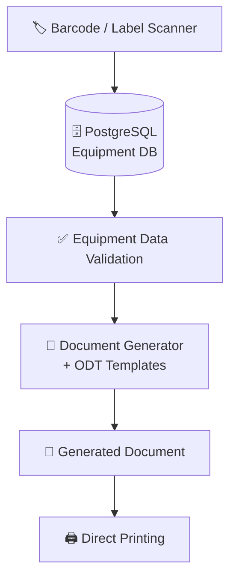
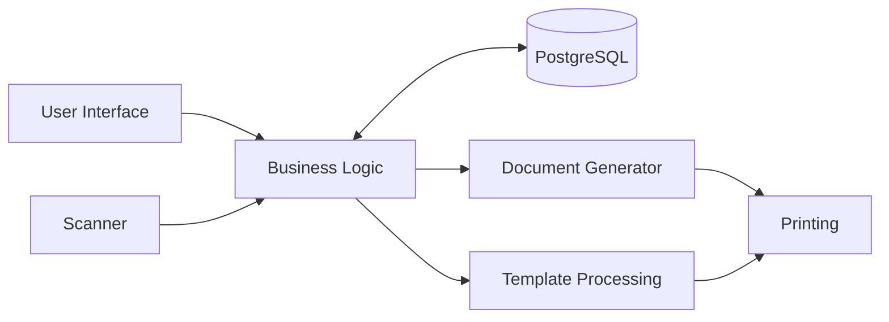

<div align="center">

# 🗂️ Equipment Decommissioning

**Desktop application for equipment decommissioning, asset identification, technical documentation and automated printing.**

[](https://www.python.org/)
[](https://www.postgresql.org/)
[](https://www.oasis-open.org/standards/)
[](https://www.microsoft.com/microsoft-365/excel)
[](https://git-scm.com/)

**Scan → Retrieve → Verify → Generate → Print**

</div>

---

## 📖 Overview

**Equipment Decommissioning** automates the paperwork behind retiring technical equipment. Instead of looking up asset data by hand and retyping it into documents, the operator scans an equipment label, the application fetches all required data from a PostgreSQL database, fills in an ODT template and sends the finished document straight to the printer.

The goal is to cut manual data entry, eliminate transcription errors and make the whole process fast and repeatable.

## ✨ Key Features

- 🏷️ **Barcode / label scanning**: identify equipment instantly with an external scanner
- 🗄️ **PostgreSQL integration**: equipment and technical data are pulled directly from the database
- 📄 **Automatic document generation**: ODT templates are populated with equipment data
- ✏️ **Built-in template editors**: edit templates and document content from inside the application
- 📊 **Excel / XLS support**: import equipment and technical passport data
- 🖨️ **Direct printing**: send generated documents to a configured printer without leaving the app
- 💾 **Saved templates**: the last used template is remembered between sessions
- 📝 **Generation report**: a text report summarising each generation run
- 🔐 **Secure configuration**: credentials stored in environment variables, never in source code

## 🖼️ Screenshots

<div align="center">

| Main window | Document generation |
| :---: | :---: |
|  |  |

| Template editor | Result / printing |
| :---: | :---: |
|  |  |

</div>

<!-- TODO: adjust the captions above to match what each screenshot actually shows -->

## 🛠️ Technology Stack

| Category | Technology | Purpose |
| --- | --- | --- |
| **Language** | Python 3.x | Core application logic and automation |
| **Database** | PostgreSQL | Storage of equipment and technical data |
| **DB driver** | PostgreSQL driver for Python | Communication between Python and PostgreSQL |
| **GUI** | Python desktop GUI toolkit | User interface and workflow |
| **Documents** | ODT (OpenDocument) | Templates and generated reports |
| **Document processing** | ODT processing library | Template population and document generation |
| **Spreadsheets** | XLS / Excel | Equipment and passport data |
| **Hardware** | Barcode / label scanner | Fast equipment identification |
| **Printing** | Python print service | Direct printing of documents |
| **Configuration** | `.env` / environment variables | Secure database configuration |
| **Version control** | Git & GitHub | Source control and hosting |

<!-- TODO: replace the generic names above with the exact libraries from your imports / requirements.txt (e.g. DB driver, GUI toolkit, ODT and XLS libraries) -->

## 🔄 Workflow



## 🧩 Project Structure

```
Equipment-Decommissioning/
├── konfiguracja/            # Application configuration
├── orzeczenia/              # Generated decommissioning documents
├── szablony/                # Document templates
├── database.py              # Database communication and data retrieval
├── disposal_objects.py      # Equipment / decommissioning data structures
├── generator.py             # Document generation logic
├── gui_generator.py         # Main GUI and generation workflow
├── skaner.py                # Scanner / label reader integration
├── print_service.py         # Direct printing
├── odt_editor.py            # ODT document processing
├── rich_odt_editor.py       # Advanced ODT editing
├── template_editor.py       # Template editing and management
├── szablon_orzeczenie.odt   # Base decommissioning document template
├── paszporty.xls            # Technical passport data
├── ostatni_szablon.json     # Last used template (session state)
├── raport_generatora.txt    # Generation report
└── .gitignore
```

### Main modules

| Module | Description |
| --- | --- |
| `database.py` | Database connection and queries |
| `disposal_objects.py` | Data models for equipment and decommissioning |
| `generator.py` | Fills templates and produces documents |
| `gui_generator.py` | Main window and end-to-end workflow |
| `skaner.py` | Reads input from the label scanner |
| `print_service.py` | Sends documents to the printer |
| `odt_editor.py` | Reads and modifies ODT files |
| `rich_odt_editor.py` | Rich-text editing of ODT content |
| `template_editor.py` | Creates, edits and manages templates |

## 🏗️ Architecture



The project follows a modular architecture: UI, database layer, hardware input, document generation and printing are separated into dedicated modules.

## 🚀 Getting Started

### Prerequisites

- Python 3.x
- A running PostgreSQL instance with the equipment database
- (Optional) a barcode / label scanner and a configured printer

### Installation

```bash
git clone https://github.com/Drwalpawel20/Equipment-Decommissioning.git
cd Equipment-Decommissioning

python -m venv venv
# Windows
venv\Scripts\activate
# Linux / macOS
source venv/bin/activate

pip install -r requirements.txt
```

### Configuration

Create a `.env` file in the project root:

```env
DB_HOST=your_host
DB_PORT=5432
DB_NAME=your_database
DB_USER=your_username
DB_PASSWORD=your_password
```

> 🔒 `.env` is excluded from version control via `.gitignore`. Never commit credentials.

### Run

```bash
python gui_generator.py
```

## 📋 Usage

1. Start the application.
2. Scan the equipment label (or enter the identifier manually).
3. Review the equipment data retrieved from the database.
4. Choose or edit the document template.
5. Generate the document.
6. Print it directly from the application.

## 🗺️ Roadmap

- [ ] `requirements.txt` with pinned dependencies
- [ ] Export to PDF
- [ ] Multi-user support and operation history
- [ ] Installer / packaged executable

## 👤 Author

**Paweł** ([@Drwalpawel20](https://github.com/Drwalpawel20))

---

<div align="center">

⭐ If you find this project useful, consider giving it a star.

</div>
